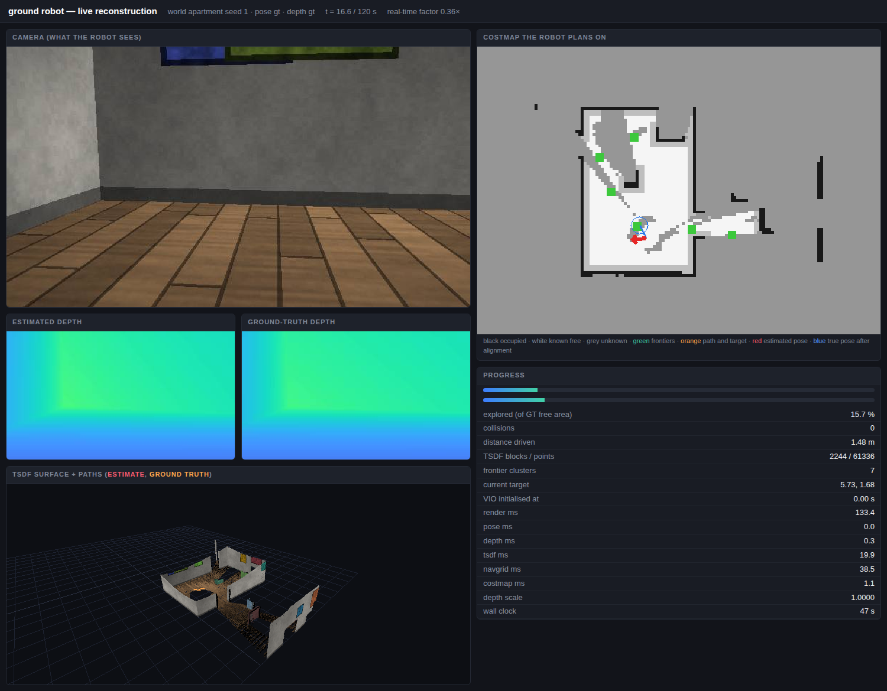

# 3d-recon: phone-only room scanning

**Turn an ordinary Android phone into a room scanner: no LiDAR, no depth sensor, no ARCore required.**
3d-recon builds 360° panoramas, metric 3D point clouds and live TSDF reconstructions of indoor spaces from
the phone's camera and motion sensors, using visual-inertial odometry and monocular depth estimation.



*The simulator dashboard: a virtual robot explores a procedural apartment while the same reconstruction
code that runs on the phone builds the map.*

## What's in it

| Part | What it does | Where |
|---|---|---|
| **Capture → panorama + point cloud** | An Android capture app with a guidance HUD, then Python that projects a 360° equirectangular panorama by pose and builds a cleaned metric point cloud with Depth Anything 3 | `clients/android/`, `core/`, `scripts/capture/`, `viewer/` |
| **Live Scan (on-device)** | Reconstruction on the phone itself: OpenVINS visual-inertial odometry, monocular depth (Depth Anything V2 / Metric3D / UniDepth, CPU or NPU), voxel-hash TSDF fusion, relocalization and saved PLY segments | `video-recon/android/` |
| **Video + sensors reconstruction** | Offline reconstruction from an ordinary video plus raw IMU and magnetometer, without ARCore: SfM, depth, TSDF fusion, mesh and cloud export | `video-recon/videorecon/` |
| **Ground-robot simulator** | The phone pipeline in a synthetic world: procedural apartments, simulated camera and 200 Hz IMU, frontier exploration and A* planning, with metrics against ground truth | `video-recon/sim/` |
| **Viewers** | Dependency-free single-file HTML viewers for panoramas and point clouds | `viewer/` |

**Who it's for:** developers and researchers working on mobile 3D scanning, indoor mapping, AR, real-estate
capture or robotics who want a phone-only pipeline they can read and change.

## How it works

```
Phone camera + IMU ──► visual-inertial odometry (pose) ──┐
                                                         ├──► TSDF fusion ──► mesh / point cloud / PLY
Phone camera ────────► monocular depth (per frame) ──────┘
                                     ▲
                       scale fixed per frame against sparse VIO / ARCore points
```

Monocular depth models give good relative shape but the wrong scale per frame. The pipeline anchors each
frame to metric points from the motion estimate, rejects inconsistent pixels and flying edges, and only
fuses depth when tracking is healthy. Every stage records what it measured: see the findings in
[`docs/`](docs/) and [`video-recon/docs/`](video-recon/docs/).

## Quick start

### Panorama and point cloud from a capture

```bash
uv sync
# 1. Capture with clients/android: stand still, turn, press "Take picture" at each target
adb pull /sdcard/Android/data/com.recon.poselogger/files/captures/bundle_<uuid> data/captures/

# 2. 360 panorama, projected by pose
python scripts/capture/equirect.py data/captures/bundle_<uuid> out/sessions/equirect.jpg 4096

# 3. Metric point cloud with Depth Anything 3 (small)
python scripts/capture/da3_cloud.py data/captures/bundle_<uuid> out/cloud.bin small 900000

# 4. View
cp viewer/panorama.html out/index.html && cp viewer/cloud.html out/cloud.html
cd out && python -m http.server 8777
```

The cloud builder removes flying depth-edge pixels, gives each frame one vote per voxel, and rejects a
cell only when it lacks both multi-frame support and occupied neighbours. Add `--depth-cache DEPTH.npz`
to tune the cloud without rerunning the depth model.

### Live Scan on the phone

Build `video-recon/android` in Android Studio (arm64, Android 12+). The native build expects patched
OpenVINS sources at `OV_ROOT` (see `video-recon/android/app/src/main/cpp/CMakeLists.txt`). Model files are
not in this repository: export them with the scripts in `video-recon/vio/` and `video-recon/tools/` into
`app/src/main/assets/models/`. Test steps are in
[`video-recon/docs/live-reliability-2026-10-07.md`](video-recon/docs/live-reliability-2026-10-07.md).

### Simulator

```bash
# one run with the live dashboard on port 8090 (worlds: apartment, corridor, open)
python video-recon/sim/run.py --world apartment --seed 1 --pose gt --depth gt \
    --duration 120 --out out/sim/demo --dashboard 8090

# the pose x depth matrix
python video-recon/sim/sweep.py --seeds 1 2 --duration 120
```

Results and findings: [`video-recon/docs/sim-results.md`](video-recon/docs/sim-results.md).

## Tests

```bash
pytest harness/tests video-recon/tests -q
cd core && cargo test
cd clients/android && ./gradlew :app:testDebugUnitTest
```

## Status

Research-grade and under active development. Honest state, measured:

- **Panorama + cloud:** works end to end on real hardware (Samsung S23 Ultra). Per-frame scale fitting
  cut frame-to-frame scale spread from 2.36× to 1.11× and median depth error from 0.36 m to 0.18 m
  ([details](docs/capture-to-cloud.md)).
- **Live Scan:** builds and runs on the phone, but handheld tracking is not yet reliable enough for
  everyday use: startup, drift and relocalization are the open problems.
- **Simulator:** runs the full closed loop; with real VIO in the loop, tracking is the weak link.

See [ROADMAP.md](ROADMAP.md) for what's next.

## Layout

```
clients/android/     Kotlin capture app: manual shutter, guidance HUD
core/                Shared Rust capture core + UniFFI bindings
harness/recon/       Python for the capture path: bundle I/O, depth adapters, Kepler torch shims
scripts/capture/     equirect.py, da3_cloud.py and diagnostics
viewer/              panorama.html, cloud.html: single-file viewers
video-recon/         video + sensors reconstruction, Live Scan app, simulator, VIO tools
docs/                design, measurements and the licensing audit
```

## License

3d-recon is free software under the [GNU Affero General Public License v3.0](LICENSE).
You can use, change and share it. If you distribute it, or run a modified version as a network service,
you must publish the complete source under the same license.

**Commercial licensing:** if AGPL doesn't work for your product, contact Charalambos Rotsides at
[lhampis@gmail.com](mailto:lhampis@gmail.com) about a commercial license for the code in this repository.

Copyright (C) 2026 Charalambos Rotsides

### Third-party components

| Component | License | Notes |
|---|---|---|
| [OpenVINS](https://github.com/rpng/open_vins) | GPL-3.0 | Compiled into Live Scan; sources not included |
| Depth Anything V2 (Small) | Apache-2.0 | Weights not included |
| [Depth Anything 3](https://github.com/ByteDance-Seed/Depth-Anything-3) | Code Apache-2.0; weights vary by size | Weights not included; check the license of the size you use |
| [XFeat](https://github.com/verlab/accelerated_features) | Apache-2.0 | Weights not included |
| Ceres Solver | BSD-3-Clause | |
| Metric3D, UniDepth | See upstream; UniDepth weights are non-commercial | Optional; only used by export tools |

Model weights are never stored in this repository; you obtain them yourself under their own licenses.
