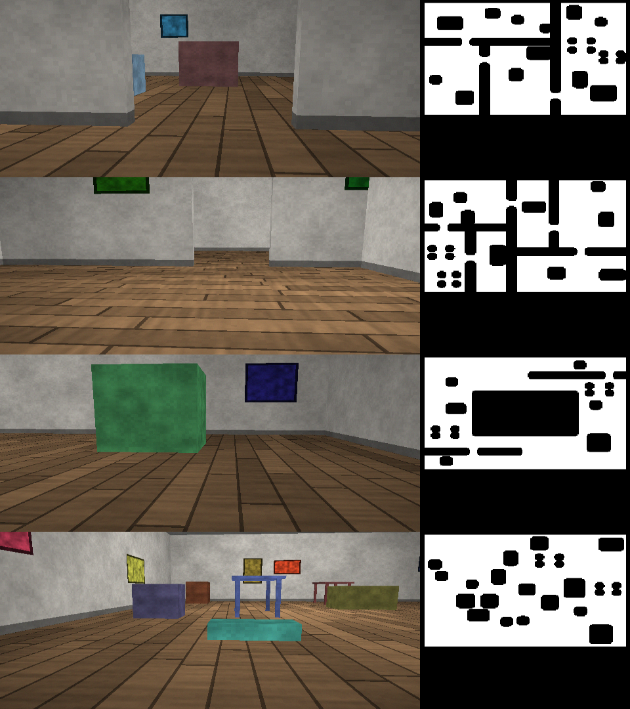

# A ground robot running the phone's live pipeline (2026-09-04)

The phone's live stack — OpenVINS pose, monocular ONNX depth, the voxel-hash TSDF in
`android/app/src/main/cpp/tsdf.cpp` — now drives a simulated differential-drive robot through a
procedural indoor world. The robot explores and navigates on **only** the pose and the map it
builds. Ground truth exists in the simulator and is read in exactly two places: `eval.py`, and
the progress line printed during a run. `navgrid.py`, `planner.py` and `explore.py` cannot see
it — a test parses their imports and fails if any of them reaches for `world.py`, `vehicle.py`
or `sensors.py`.

## What was built

```
video-recon/sim/
  world.py         procedural apartment / corridor / hall; Open3D RaycastingScene; the GT free
                   grid at 5 cm; procedural shading in numpy (Open3D raycasting has no colour)
  sensors.py       pinhole camera 640x360 / 70 deg HFOV / 20 fps, mounted 0.50 m up, pitched
                   8 deg down; 200 Hz IMU differentiated from the true body pose
  vehicle.py       differential drive, v<=0.6, |w|<=1.2, a<=0.8, alpha<=2.5, refused collisions,
                   suspension wobble (0.5 deg pitch/roll at 2-4 Hz, 5 mm bob)
  pose_sources.py  gt | gt_noisy (drifting odometry, optional scale bias) | vio (real OpenVINS)
  depth_sources.py gt | gt_noisy | da3 | dav2 | metric3d | unidepth, the phone's preprocessing
  tsdf_c.cpp       extern "C" shim; tsdf.cpp is compiled unchanged and driven through ctypes
  tsdf.py          the Python side, same parameters as LiveActivity (3 cm, trunc 4, w 16/2, 6 m)
  navgrid.py       3D log-odds grid at 10 cm + the 2D costmap
  explore.py       frontier clustering, information-per-metre scoring, commitment, blacklist
  planner.py       A*, string pulling, pure pursuit
  run.py           the closed loop; dashboard.py + dashboard.html the live view
  eval.py          Umeyama alignment and every metric; sweep.py the pose x depth matrix
  build.sh, vio_bin.sh, config/*.yaml
video-recon/vio/vio_stream.cpp    streaming OpenVINS runner (stdin/stdout line protocol)
video-recon/tests/test_sim_*.py   8 test files
```



*What the camera sees at 0.50 m, and the ground-truth free-space grid beside it: `apartment`
seeds 1 and 2, `corridor` seed 1, `open` seed 1. 12 x 9 m, 2.6 m ceiling, 0.9 m doorways,
8-20 obstacles, 63-79 m² of navigable floor.*

## How to run it

```bash
video-recon/sim/build.sh                     # compiles the phone's tsdf.cpp into libtsdf.so
~/ai/envs/kepler-gpu/bin/python video-recon/sim/run.py \
    --world apartment --seed 3 --pose vio --depth metric3d --duration 900 \
    --out out/sim/demo --dashboard 8779      # http://localhost:8779/ and on the LAN
~/ai/envs/kepler-gpu/bin/python video-recon/sim/eval.py out/sim/demo
~/ai/envs/kepler-gpu/bin/python video-recon/sim/sweep.py --duration 120 --seeds 1 2
~/ai/envs/kepler-gpu/bin/python -m pytest video-recon/tests -q          # add -m "not slow" to skip VIO
```

## The exact model preprocessing (read out of the Android code)

`android/.../live/DepthRunner.kt` is the authority; `depth_sources.py` reproduces it exactly.

* The camera frame is resampled to the model's input grid by **nearest neighbour with integer
  index maps** — `sy = y * sh / ih`, `sx = x * sw / iw`, integer division, no interpolation and
  no antialiasing. On the phone this happens twice (YUV to a 322x182 RGBA buffer in
  `LiveActivity.onFrame`, then `DepthRunner.run` to the model grid); the composition is one
  nearest resample, which is what the simulator does from 640x360 straight to 182x322.
* Normalisation is ImageNet: `(v/255 - mean) / std` with mean `(0.485, 0.456, 0.406)` and std
  `(0.229, 0.224, 0.225)`, laid out CHW float32.
* DA3-Small takes a five-dimensional tensor `image [1, 1, 3, 182, 322]` (a leading view axis);
  the other three take `[1, 3, H, W]`. DAv2's input is named `pixel_values`, the rest `image`.
* Intrinsics-aware models get `K` (UniDepth) or `intrinsics` as `[1, 3, 3]` built from the
  source intrinsics scaled to the model grid: `fx * iw/sw, fy * ih/sh, cx * iw/sw, cy * ih/sh`.
* Output handling by family:
  * `metric3d` — canonical depth: multiply by `fx_model / 1000` (its canonical camera has
    fx = 1000 px). Its output grid is **180x320**, not the 182x322 it was fed; the phone reads
    the returned array's shape and rebuilds the intrinsics at that size, and so does the sim.
  * `unidepth` — metric depth, used as it comes.
  * `da3` — relative *depth*: multiply by one scale.
  * `dav2` — relative *inverse* depth: `1/z = a*d + b`, two unknowns.
* The phone gets the scale from the VIO SLAM landmarks that project into the frame (median
  ratio for DA3, a least-squares line for DAv2). The robot has something better and that is
  what the simulator uses: the camera is bolted **0.50 m above the floor**, so for every pixel
  in the lower third whose ray points below the horizon (gravity taken from the pose) the depth
  a floor point *must* have is `-0.50 / (ray . up)`. Fitting DA3's single scale is then a median
  of ratios, refined twice by keeping the pixels within 10 % of it — a cheap RANSAC on the
  dominant plane. DAv2's two parameters are a least-squares line with two outlier-rejection
  passes. When fewer than 15 % of the lower third agrees, the previous frame's fit is kept.

## OpenVINS: the rebuild and the streaming runner

The build directory had been deleted and `~/ai/vio/run_offline.bin` could not find
`libov_msckf_lib.so`. Rebuilt exactly as `vio/README.md` says (`cmake -G Ninja -DENABLE_ROS=OFF
-DCMAKE_BUILD_TYPE=Release -DCMAKE_POLICY_VERSION_MINIMUM=3.5 -DCMAKE_PREFIX_PATH=$CONDA_PREFIX
-DCMAKE_CXX_FLAGS="-include cassert"`), 39 targets, no errors. **It worked first time**, in
about six minutes.

`vio/vio_stream.cpp` is `run_offline.cpp` turned inside out: instead of reading a directory it
reads a line protocol on stdin and answers on stdout, flushing after every camera update.

```
in   I t_ns wx wy wz ax ay az        IMU sample
     C t_ns /abs/path/frame.png      grayscale frame
     Q                               quit
out  P t px py pz qx qy qz qw        TUM, Hamilton, IMU->global (identical to run_offline)
     L t n x y z ...                 the current SLAM landmarks
     N t                             a camera update before initialisation
     K R_ItoC(9) p_IinC(3) intrinsics(8) dt   the final online calibration
```

One thing had to be worked around: **OpenVINS `printf`s to stdout**, and `YamlParser` and
`print_and_load` write there before `verbosity` can silence them. Any of that reaching the pipe
would desynchronise the protocol. `vio_stream` therefore `dup()`s the real stdout for the
protocol and points fd 1 at stderr, so the caller's pipe carries protocol lines only and all
library chatter lands in `<out>/vio.log`.

`sim/config/` holds the estimator configuration for the simulated rig: 640x360, the sim
intrinsics (457.007, 457.007, 319.5, 179.5 for a 70 deg HFOV), `T_imu_cam` set to the analytic
mount, `update_rate: 200`, the same noise densities the simulator injects, and — as on the
phone — online calibration of extrinsics, intrinsics and time offset left on.
`estimator_config_nocalib.yaml` freezes all three for comparison.

## Findings

### Does OpenVINS initialise on a ground robot? Yes, in 1.6 s. Does it *hold*? Not for long.

Dynamic initialisation converged **1.6 to 1.8 s** into every run, 0.8 s after the robot started
moving — much faster than the ~9 s the handheld walk in `vio/README.md` needed. The reason is the
initialisation manoeuvre (0.5 m forward, 30 deg left, 30 deg back, a short forward-and-back) plus
the modelled suspension wobble (0.5 deg of pitch/roll at 2-4 Hz and 5 mm of bob, which is part of
the *true* motion and therefore moves the camera as well as the IMU). A ground robot driving at
constant velocity on a plane leaves monocular scale unobservable; that manoeuvre is what makes the
accelerometer informative.

Staying converged was much harder, and getting there took a chain of fixes. The measure below is
the estimated distance from the start at t = 30 s against the true distance, on `apartment`, 40 s
runs, `--depth gt` so only the pose is under test:

| variant | est. \|d\| at 30 s | truth | ATE rmse | Sim(3) scale | diverged | explored |
|---|---|---|---|---|---|---|
| as first written (no IMU lead) | 16.6 m | 1.4 m | 1689 cm | 0.005 | yes | 0 % |
| + zero-velocity updates | 16.3 m | 0.5 m | 797 cm | 0.019 | yes | 2 % |
| **IMU lead fixed**, online calibration | 95.0 m | 0.4 m | 5478 cm | 0.002 | yes | 0 % |
| IMU lead + ZUPT | 26.1 m | 0.8 m | 856 cm | 0.005 | yes | 0 % |
| IMU lead + **5 s settle**, online calib, seed 2 | 0.6 m | 0.5 m | 33 cm | 0.62 | no | 25 % |
| IMU lead + 5 s settle, online calib, seed 1 | 25.0 m | 0.2 m | 1937 cm | 0.006 | yes | 0 % |
| IMU lead + settle + ZUPT, seed 1 | 2.1 m | 0.4 m | 140 cm | 0.07 | no | 18 % |
| IMU lead + settle, **no online calibration**, seed 1 | 0.9 m | 0.9 m | **11 cm** | **0.90** | no | 25 % |
| IMU lead + settle, no online calibration, seed 2 | 2.5 m | 2.6 m | 109 cm | 0.51 | no | 1 % |

Three things came out of that:

1. **The bug was mine, in the streaming plumbing.** `run_offline.cpp` feeds OpenVINS every IMU
   sample up to `t + 0.05` *before* handing over the frame at `t`. `VioStream` fed IMU as it was
   produced, so at frame time `t` the filter held IMU only up to `t - 5 ms` and had to extrapolate
   every update. `VioPose` now queues each frame and releases it only once the estimator already
   holds IMU past it. The proof that this was the whole plumbing story: with `--record-vio-input`
   the same stream replayed through `run_offline` now gives **26.25 m** where the live stream gives
   **26.13 m** — streaming and offline agree to 0.5 %, which they did not before.
2. **Zero-velocity updates were only masking that bug.** On a stream captured *before* the fix,
   ZUPT improved the offline replay from 148 m to 2.5 m. On a stream captured *after* it, the
   plain config gives 0.46 m and ZUPT gives 26 m — ZUPT is actively harmful once the timing is
   right, because a robot that is turning in place is not stationary and the ZUPT chi-squared test
   accepts it anyway. `estimator_config_zupt.yaml` is kept for the record; it is not the default.
3. **Online calibration destabilises this rig.** The simulated camera is known exactly, and letting
   the filter also solve for intrinsics, extrinsics and time offset on a short, weakly exciting
   ground-robot trajectory is what turns a 11 cm error into divergence.
   `estimator_config_nocalib.yaml` is what the VIO sweep rows use.

Two more things were tried and did *not* help. A perfect IMU (`--imu-noise 0`) made the pre-fix
baseline **worse** (615 m at 30 s), so the injected sensor noise was never the cause; and static
initialisation (`estimator_config_static_init.yaml`) never initialises at all on this robot,
because the manoeuvre starts moving before its 1.5 s window closes.

**And it still does not last two minutes.** Every 120 s VIO sweep row diverges: the filter tracks
for roughly the first 30 to 60 s (11 to 33 cm ATE at 40 s) and then loses scale, so the sweep's VIO
rows explore essentially nothing. The honest summary is that OpenVINS, configured as the phone
configures it and fed a ground robot that spends most of its time turning on the spot, is good for
tens of seconds and not for minutes. What would be tried next, in order: reward translation in the
frontier scoring so the robot stops pirouetting, feed the wheel odometry the simulator already has
as a velocity prior, and add loop closure.

Two robustness fixes came out of the same failures. `NavGrid._index` computed its flat index in
int32; once a runaway pose grew the grid past 2^31 cells the index wrapped negative and
`np.bincount` raised, killing five of the six VIO sweep runs. Indices are int64 now, the grid
extent is capped at 40 x 40 x 8 m, and `run.py` watches the estimate: more than 8 m/s of sustained
motion (averaged over a second; the robot does 0.6 m/s, a healthy filter's correction peaks near 4,
a runaway sustains 13) or more than 30 m from the start logs a `vio_diverged` event, stops mapping,
and falls back to the bounded initialisation manoeuvre. It deliberately does **not** stop the robot
dead: standing still is exactly what makes monocular scale unobservable, so a stopped robot can
never recover.

### How good is each depth model in this world?

Ten viewpoints spread over `apartment` seed 3, comparing against the raycast depth
(median over the valid pixels of each frame, then the median over frames):

| model | median z/z_gt | per-view spread | median relative error | ONNX ms (6 threads) |
|---|---|---|---|---|
| `metric3d` (Metric3D v2 ViT-S) | 1.09 | 0.92 – 1.89 | 11.5 % | 171 |
| `unidepth` (UniDepth v2 ViT-S) | 2.04 | 1.49 – 2.98 | 104 % | 541 |
| `da3` (DA3-Small + floor scale) | 0.99 | 0.91 – 2.58 | 5.2 % | 105 |
| `dav2` (DAv2-Small int8 + floor fit) | 1.04 | 0.90 – 1.73 | 11.4 % | 180 |
| `gt_noisy` (3 % + 8 % at edges) | 1.00 | – | 2.8 % | 2 |

The headline is that **the floor-plane scale beats both metric checkpoints**. DA3-Small, which
predicts only relative depth, becomes the most accurate source in the sim once the known 0.50 m
camera height fixes its scale — 5 % median error against Metric3D's 11 % and UniDepth's 104 %.
UniDepth is not slightly wrong, it is a **factor of two too far** on every view tested (its own
floor-plane correction would be 0.51). Metric3D is 9 % too far on average and its per-view scale
wanders between 0.92 and 1.89.

Two caveats worth stating plainly. First, these are synthetic images: flat-shaded axis-aligned
boxes with procedural texture, nothing a network trained on photographs has seen, so the metric
checkpoints are being asked to generalise badly out of distribution and it is unsurprising that
they do worse here than on the phone's real footage. Second, the floor-plane trick has a real
advantage the phone does not have — a rigidly mounted camera at a known height — so this is a
statement about ground robots, not about the models.

### Does the robot navigate on its own estimate? Yes, with a true or a drifting pose.

`apartment` seed 1, 120 s, perfect pose and perfect depth: the robot leaves its start point, maps
the first room, drives through a 0.9 m doorway and clears the shadows behind the furniture,
covering **32 % of the 72 m² of ground-truth free floor with zero collisions** over 14.1 m driven.
TSDF surface accuracy against the ground-truth mesh is a **median 0.23 cm, p90 0.49 cm** — the
fusion working exactly as intended, since with a perfect pose and perfect depth the only error left
is the 3 cm voxel grid. Seed 2 reaches 47 %.

Drifting odometry costs surprisingly little: `gt_noisy` (2 % of distance + 3 mm per step, 0.3 deg/s)
explores 32 % on seed 1 with an ATE of 5.8 cm and a map median of 5.7 cm. What the robot cannot
absorb is a *scale* error, because the costmap and the TSDF then disagree with the world about how
big the room is.

The full matrix (`apartment`, seeds 1 and 2, 120 s each, also in
[`sim-results.md`](sim-results.md)):

| pose | depth | seed | explored % | collisions | ATE rmse cm | scale | map median cm | map p90 cm | completeness % | dist m | VIO init s | RTF |
|---|---|---|---|---|---|---|---|---|---|---|---|---|
| gt | gt | 1 | 32 | 0 | 0.0 | 1.0 | 0.23 | 0.49 | 18 | 14.12 | 0.0 | 0.273 |
| gt | gt | 2 | 47 | 5 | 0.0 | 1.0 | 0.27 | 0.54 | 23 | 14.77 | 0.0 | 0.275 |
| gt | metric3d | 1 | 19 | 0 | 0.0 | 1.0 | 20.48 | 71.13 | 4 | 10.66 | 0.0 | 0.208 |
| gt | metric3d | 2 | 22 | 6 | 0.0 | 1.0 | 11.5 | 58.5 | 5 | 9.79 | 0.0 | 0.209 |
| gt | da3 | 1 | 22 | 4 | 0.0 | 1.0 | 13.09 | 49.71 | 9 | 11.4 | 0.0 | 0.232 |
| gt | da3 | 2 | 29 | 3 | 0.0 | 1.0 | 37.5 | 190.78 | 6 | 11.39 | 0.0 | 0.224 |
| gt_noisy | gt | 1 | 32 | 6 | 5.8 | 0.9831 | 5.65 | 15.11 | 10 | 12.95 | 0.0 | 0.271 |
| gt_noisy | gt | 2 | 20 | 0 | 8.7 | 1.0379 | 6.05 | 21.99 | 10 | 11.12 | 0.0 | 0.279 |
| gt_noisy | metric3d | 1 | 15 | 0 | 6.4 | 1.0192 | 19.85 | 56.97 | 6 | 9.16 | 0.0 | 0.208 |
| gt_noisy | metric3d | 2 | 10 | 0 | 9.5 | 0.9587 | 18.81 | 61.03 | 4 | 11.6 | 0.0 | 0.209 |
| gt_noisy | da3 | 1 | 22 | 7 | 7.7 | 0.9732 | 13.59 | 56.44 | 10 | 12.41 | 0.0 | 0.229 |
| gt_noisy | da3 | 2 | 6 | 4 | 11.2 | 1.0322 | 12.34 | 45.91 | 6 | 9.48 | 0.0 | 0.232 |
| vio | gt | 1 | 0 | 0 | 2816.6 | 0.0097 | 1192.52 | 1719.03 | 0 | 15.2 | 1.6 | 0.383 |
| vio | gt | 2 | 0 | 5 | 1660.0 | 0.0334 | 1321.08 | 1689.54 | 0 | 19.21 | 1.65 | 0.384 |
| vio | metric3d | 1 | 5 | 0 | 265.1 | 0.1853 | 49.65 | 373.43 | 6 | 12.84 | 1.6 | 0.264 |
| vio | metric3d | 2 | 0 | 16 | 12532.1 | 0.0037 | 4635.23 | 5036.49 | 0 | 18.36 | 1.65 | 0.329 |
| vio | da3 | 1 | 0 | 0 | 24611.7 | 0.0009 | 11618.32 | 12371.05 | 0 | 14.71 | 1.6 | 0.326 |
| vio | da3 | 2 | 0 | 0 | 7543.3 | 0.0022 | 7379.27 | 7842.55 | 0 | 16.03 | 1.65 | 0.304 |


### Per-stage timings and real-time factor

Measured on 12 cores, no GPU, at 640x360:

| stage | rate | mean ms |
|---|---|---|
| render (raycast + procedural shade + sensor noise) | 20 Hz | 92 |
| pose, `gt` | 20 Hz | 0.01 |
| pose, `vio` (OpenVINS + PNG write) | 20 Hz | ~20 |
| depth, `gt` | 4 Hz | 0.3 |
| depth, `metric3d` / `da3` / `dav2` / `unidepth` | 4 Hz | 200 / 105 / 180 / 440 |
| TSDF integrate + surface extract (the phone's C++) | 4 Hz | 23 |
| navgrid ray carving + footprint clearing | 4 Hz | 42 |
| costmap + inflation | 2 Hz | 1.4 |

The renderer is the simulator's bottleneck — more than OpenVINS, the depth network and the TSDF
combined. It started at 112 ms per frame (real-time factor **0.27**) and is now **92 ms, RTF
0.44**, from: float32 throughout, a 32-bit value-noise hash instead of a 64-bit one, the face axis
taken from a per-triangle table instead of an `argmax` over the normals, a cached vignette, sensor
noise drawn from a pool, one fewer smooth octave on the wall and the floor (replaced by a cheaper
uninterpolated hash, which raised the Shi-Tomasi corner count from 174 to the 250 cap), and — the
biggest single win — **shading one luminance channel instead of three on the 16 frames in 20 that
only VIO sees**. Dropping to `--width 480 --height 270` gives **59 ms and RTF 0.59** with no
measurable loss (explored 26 % vs 24 %, map median 0.27 vs 0.22 cm); 640x360 was kept for the sweep
so every row is comparable.

## What did not work, and what it cost

Every one of these was found by running the thing and looking at the output, and each cost real
time, so they are listed with what the symptom looked like.

* **The floor was mapped as an obstacle.** Depth rays hit the floor at `z ~ floor_z`, and whether
  that cell falls inside the 0.05-0.80 m height band depends on how the grid happens to be aligned.
  It did; the whole visible floor became lethal and the robot had nowhere to go.
  `NavGrid.integrate` now treats a hit within 12 cm of the estimated floor as free space.
* **Optimistic planning drove the robot into walls it had never seen** — 138 collisions in 22 s.
  Planning is now confined to known-free space, with unknown cells crossable only where they touch
  it (two cells), which bridges the speckle holes the ray carving leaves at long range.
* **A 0.35 m inflation closes every 0.9 m doorway.** The brief asks for robot radius plus a 0.10 m
  margin as the hard block. Geometrically a 0.9 m door leaves 0.45 m of clearance either side, so a
  0.35 m block leaves 0.10 m of lateral freedom — less than one grid cell once the mapped wall is a
  cell thick. The hard block is therefore the radius plus half a cell (0.30 m) and the specified
  margin is a steep cost band on top. **A deliberate departure from the brief.**
* **The camera cannot see under the robot, so A\* had no legal start cell.** The cell the robot
  stands in is never carved by its own rays, so it stayed UNKNOWN for ever, every A* call failed,
  and the robot reported "no reachable frontier" while spinning on the spot for minutes.
  `NavGrid.mark_robot` clears the footprint column each cycle, as `costmap_2d` does.
* **The frontier scoring looked at the wrong set.** Filtering frontier cells by reachability
  *splits and re-sizes* the clusters, so the twelve biggest clusters of the *unfiltered* set could
  all be unreachable while perfectly good reachable ones were never scored at all. The robot spun
  for 69 % of a run with ten reachable frontiers on the map. The scoring loop now uses the
  reachable set and only falls back to the full set when nothing reachable yields a path.
* **Re-scoring every second meant the robot never translated.** A differential drive must stop and
  turn to face a new target; picking a different one every second means it only ever turns. In one
  60 s run it drove 6 m. The explorer now commits to a target until it is reached, explored away,
  unreachable, or 25 s old.
* **Counting rotation as progress disabled the stuck detector.** A robot pinned against a wall
  still turns, because the follower keeps steering, so it reset the no-progress timer for ever: one
  run sat in the same spot from t=44 s to t=108 s, colliding every five seconds, and the escape
  never fired. Progress is translation only now, with an 8 s timeout (a 180 deg turn in place takes
  about 3 s). That one change took a 120 s run from 17 collisions / 6.0 m driven to **0 collisions
  / 14.1 m**.
* **String pulling undid the clearance the planner had just paid for.** Shortcutting on
  `isfinite(cost)` alone hugs the lethal boundary, and pure pursuit cannot track a line exactly, so
  the robot clipped walls the costmap had correctly marked. Shortcuts now have to pass through
  cells cheaper than a threshold, and the lookahead came down from 0.6 m to 0.45 m.
* **Collisions were counted per 5 ms tick**, so leaning on a wall for a second scored 200. They are
  distinct contact events now, with the raw blocked-tick count kept separately.
* **An int32 flat index killed five sweep runs.** A runaway VIO pose grew the navgrid past 2^31
  cells, the index wrapped negative and `np.bincount` raised. int64 now, plus a capped extent and
  the divergence guard described above.
* **`explored` is a strict metric.** A cell counts as free only when the *whole* 0.05-0.80 m column
  above the estimated floor is known-free, as the brief specifies. About 75 % of the columns the
  robot observed clear that bar, so the reported figure understates the mapped area by roughly a
  quarter. The costmap needs the strict definition to be safe; the metric inherits it.

## Open issues and what I would do next

1. **Monocular VIO does not survive two minutes of this robot's motion.** It initialises in 1.6 s
   and tracks to 11-33 cm for the first half-minute, then loses scale. The three things I would try,
   in order: score frontiers so that translation is rewarded and the robot stops pirouetting; feed
   the wheel odometry the simulator already produces as a velocity prior (a ground robot has it for
   free and it is exactly the missing scale observation); add loop closure.
2. **Exploration is thorough before it is broad.** Information over path length makes the robot
   clear the shadows behind the furniture in the room it is in before crossing to the next. Over
   120 s that is 32-47 % of an apartment. An explicit distance discount, or a two-tier
   "finish the room, then take the biggest door", would cover more ground per minute.
3. **UniDepth's factor-of-two error deserves a check against real footage** before concluding
   anything about the model rather than about the export or the synthetic imagery.
4. **The renderer is still the simulator's bottleneck** at 92 ms per frame, more than OpenVINS, the
   depth network and the TSDF combined. Cython, or accepting 480x270, is the next step.
5. **`sim-results.md` covers `apartment` only, seeds 1-2, 120 s.** `corridor` and `open` are built
   and tested but were never swept, and 180 s x 3 seeds was cut to 120 s x 2 to fit the machine.
